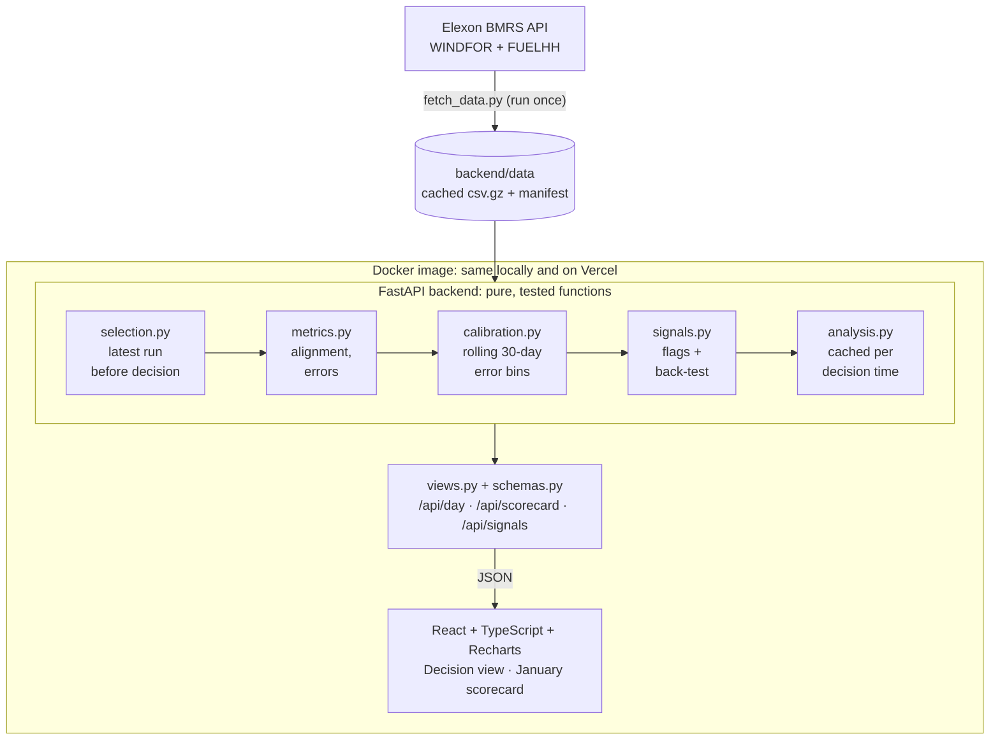

# Day-ahead Wind Cockpit

A pilot web app for a UK utility's day-ahead power purchasing team. For every delivery day in January 2026 it replays the national wind forecast the team could actually have seen at the day-ahead decision time, shows how far to trust it, and scores it against metered wind.

- **Live app:** https://qv7rkz.vercel.app
- **Video walkthrough:** _link to be added_

## What it shows

- **Decision view.** Pick a delivery day and a decision time (the GB day-ahead auction gates: EPEX 60-min 09:20, N2EX 09:50, EPEX 30-min 15:30, or any custom time). The app shows the forecast available at that moment, a bias-adjusted "expected metered wind" line, an 80% range built from past errors, the evening-peak (16:00–19:00) figures, and warning signals. A switch reveals what actually happened.
- **January scorecard.** Accuracy over all 744 delivery hours: typical miss (MAE), bias, 1-in-10 miss, range coverage, breakdowns by forecast level and lead time, a day × hour error heatmap, and a back-test of each warning signal.

## Key findings (09:20 decision time)

- The forecast missed by **2.0 GW** in a typical hour and ran **1.7 GW high** on average; it was too high in 85% of hours and on 27 of 31 days.
- When it predicted **15 GW or more**, metered wind came in lower almost every time (bias +2.7 GW). The gap also appears for hours already past at publish time, so it is mostly a difference in what the two series measure (likely curtailment and coverage), not forecasting skill.
- Correcting for past bias, learned only from earlier days, cuts the typical miss by **33%**. The 80% range caught 77% of outcomes on days it had not seen.
- Of the warning signals, only **high wind** is backed by the data (1.7× larger misses). Big revisions and steep ramps were not confirmed.

## Quick start

**Docker (recommended)**

```bash
docker compose up --build
# open http://localhost:8000
```

**Local development**

```bash
# Backend (Python 3.12)
python -m venv .venv && .venv/Scripts/activate      # Windows; use .venv/bin/activate elsewhere
pip install -r requirements-dev.txt
cd backend && uvicorn app.main:app --reload --port 8000

# Frontend (Node 22), in a second terminal
cd frontend && npm ci && npm run dev               # http://localhost:5173, proxies /api to :8000
```

**Tests and checks**

```bash
pytest -q                     # 35 backend tests
ruff check . && ruff format --check .
cd frontend && npm run lint && npm run build
```

**Refresh the cached data** (not needed to run the app)

```bash
python backend/scripts/fetch_data.py
```

## Repository layout

```
├── backend/
│   ├── app/
│   │   ├── main.py          FastAPI app: /api routes; serves the built frontend in Docker
│   │   ├── config.py        Scope, decision-time presets, thresholds (single source of truth)
│   │   ├── data.py          Loads the cached Elexon data
│   │   ├── selection.py     As-of forecast selection: latest run published before the decision
│   │   ├── metrics.py       Hourly alignment, errors, scorecard metrics
│   │   ├── calibration.py   Rolling, look-ahead-free bias correction and 80% range
│   │   ├── signals.py       Warning signals and their back-test
│   │   ├── analysis.py      Ties the steps together per decision time (cached)
│   │   ├── views.py         Builds API responses
│   │   └── schemas.py       Pydantic response models (the API contract)
│   ├── data/                Cached WINDFOR and FUELHH data + manifest.json (queries, row counts, hashes)
│   ├── scripts/fetch_data.py
│   └── tests/               pytest suite
├── frontend/
│   └── src/
│       ├── api/             Typed API client and response types
│       ├── components/      Chart, pickers, signal list, table, drawer, shared UI
│       ├── views/           Decision view and January scorecard
│       └── lib/             Formatting, URL state, theme, motion helpers
├── docs/spec.md             Product and technical spec
├── Dockerfile               Multi-stage: build frontend, serve it with the FastAPI app
├── docker-compose.yml
├── vercel.json              Vercel Services: runs the Dockerfile as a container
├── .github/workflows/ci.yml Lint, tests and frontend build on every push
├── requirements.txt         Runtime Python dependencies
└── requirements-dev.txt     Plus test and lint tools
```

## Architecture



The backend is a pipeline of small, pure, tested functions; `analysis.py` runs it once per decision time and caches the result. The Dockerfile builds the frontend in a Node stage and serves it from the FastAPI app, so the browser, the API and the data share one origin.

## How it works

1. **Data.** Elexon BMRS `WINDFOR` (national wind forecast, hourly, 8 runs a day, each with a `publishTime`) and `FUELHH` with `fuelType=WIND` (metered output, half-hourly). Fetched once for 28 Nov 2025 – 2 Feb 2026 and committed; the app never calls Elexon at runtime. No other data are used.
2. **Scope.** Purchase decisions made in January 2026 are for delivery days **2 Jan – 1 Feb 2026**.
3. **Forecast selection.** For each delivery hour, the run with the latest `publishTime` strictly before the decision time on the day before delivery. The publish schedule is read from the data (for example, 15 Jan has no 11:30 run and an extra 12:25 run).
4. **Alignment.** Each hourly forecast is compared with the mean of its two half-hourly actuals. Error = forecast − actual, so positive means over-forecast (the buyer was short).
5. **Calibration.** For a decision about day D, take the 30 delivery days ending D−2 (all settled before the decision), select their forecasts with the same rule, group the hours by forecast level (<5, 5–10, 10–15, ≥15 GW) and take the 10th/50th/90th percentile of the error. Expected line = forecast − median error; 80% range = forecast − P90 to forecast − P10. A test checks that changing actuals from D−1 onwards does not change the result.
6. **Signals.** High wind (≥15 GW), steep ramp (≥3 GW within 3 h), big revision (≥1 GW vs previous run), low wind at the evening peak (<3 GW). Each is back-tested over January and only called "backed" if flagged hours had at least 1.2× the typical miss over 24+ hours.

## Deployment

The live app runs on **Vercel Services with the container runtime**: `vercel.json` builds the same `Dockerfile` used locally, so production runs the exact image that `docker compose` runs. The Vercel project sets `PORT=8000`. Every push to `main` deploys.

## Assumptions and limits

- Default decision time 09:20 UK on D−1 (the EPEX GB 60-minute auction gate).
- December 2025 is used only as calibration history: the errors a trader would already have seen when deciding in January.
- One month is a small sample (forecast-evaluation guidance recommends at least 90 days), so results are indicative.
- Both datasets exclude wind farms connected to local distribution networks. The reason the forecast sits above metered output is not documented by Elexon or NESO; curtailment is the most likely explanation.
- No price or demand data, so the app shows wind cover and its uncertainty, not how much to buy.

## Use of AI tools

This project was built with AI assistance: Claude (Anthropic), through Claude Code, was used for domain research, code generation, tests and documentation.
